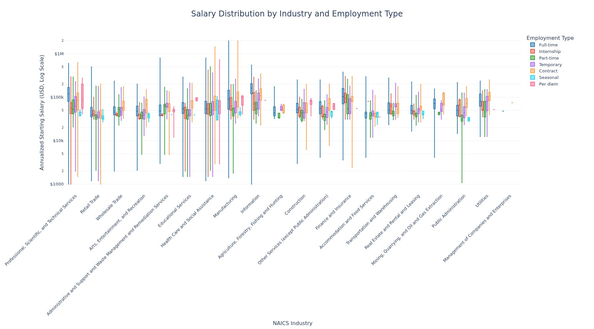
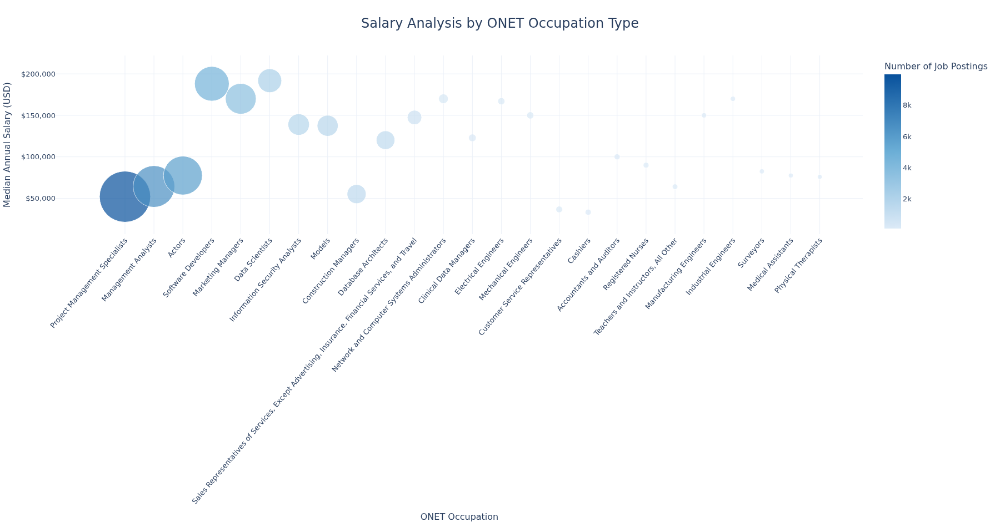
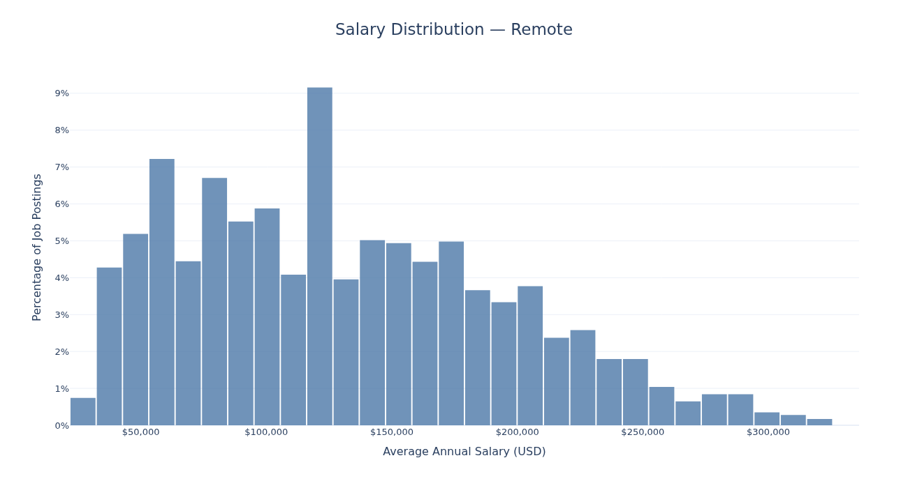
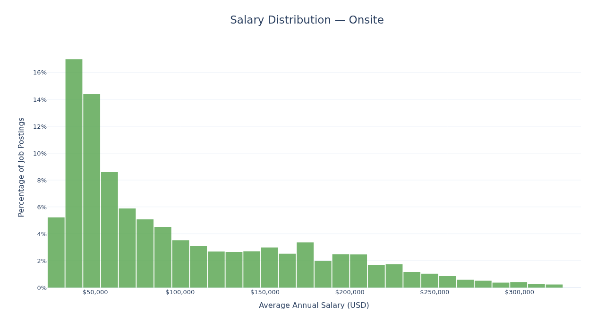

[BU MET AD688 · Big Data and Cloud Analytics for Business · Sep 2026–Present]{.eyebrow}

# From 815,193 job postings to labor-market insight

This project is the expanded portfolio version of the **Employability Analytics** project listed on my CV. I use a 2.8 GB collection of 20 Parquet files on an AWS EC2 environment to build a distributed workflow for job-market analysis, moving from data architecture and Spark SQL toward salary, education, remote-work, and later machine-learning analysis.

::: {.case-metrics}
::: {.case-metric}
[815,193]{.case-value}
[job postings]{.case-label}
:::
::: {.case-metric}
[51,795]{.case-value}
[companies]{.case-label}
:::
::: {.case-metric}
[20]{.case-value}
[Parquet files]{.case-label}
:::
:::

::: {.badge-row}
[PySpark]{.tech-badge}
[Spark SQL]{.tech-badge}
[AWS EC2]{.tech-badge}
[Parquet]{.tech-badge}
[Quarto]{.tech-badge}
[Python]{.tech-badge}
:::

## Development environment

The portfolio source and the AD688 analytical work are developed through **VS Code Remote SSH on the assigned AWS EC2 instance**. This Quarto page is maintained in the EC2 project directory and rendered from there before being pushed to GitHub.

::: {.code-proof}
**EC2 evidence**

- Workspace: `/home/ubuntu/shoufengchen.github.io`
- Python: **3.12.3**
- Quarto: **1.10.18**
- Course data directory: `/home/ubuntu/Jobs_2026`
- Data footprint on EC2: **2.8 GB across 20 Parquet files**
:::

The repository also contains `assets/ad688/ec2-environment.txt`, generated directly on EC2 during this portfolio build.

## Project progression

Rather than presenting each course submission as an isolated homework page, I treat the AD688 assignments as stages of one continuing analytics project.

::: {.stage-grid}
::: {.stage-card}
### Distributed data architecture

**M02-A**

Loaded Parquet data into Spark, normalized fields, designed relational tables for companies, industries, locations, and job postings, and answered business questions with Spark SQL.
:::

::: {.stage-card}
### Labor-market analytics

**M03-A**

Expanded the workflow into salary normalization, industry and occupation comparisons, education-level analysis, and Remote / Hybrid / Onsite comparisons with reusable PySpark and Plotly workflows.
:::

::: {.stage-card}
### Ongoing extension

**Current project direction**

Continue the same pipeline toward feature engineering, model evaluation, and business reporting rather than treating modeling as a separate project.
:::
:::

## Phase 1 — Distributed data architecture

### Loading the course dataset with Spark

The workflow starts by creating a Spark session on EC2 and reading the course Parquet files. The original assignment used a sample switch while developing queries, while later analysis ran over the complete set of files.

```python
from pathlib import Path
from pyspark.sql import SparkSession

spark = (
    SparkSession.builder
    .appName("JobPostingsAnalysis")
    .master("local[*]")
    .getOrCreate()
)

data_dir = Path("/home/ubuntu/Jobs_2026").resolve()
parquet_files = sorted(data_dir.glob("*.parquet"))

df = spark.read.parquet(
    *[path.as_uri() for path in parquet_files]
)

df.createOrReplaceTempView("job_postings")
```

### Relational design and Spark SQL

A central goal was to move beyond one flat dataset. I separated company, industry, location, and job-posting information into reusable analytical tables and joined them for targeted questions.

The following query is adapted from my M02-A submission and compares specialized occupations within the computing infrastructure / data processing industry.

```python
query1_df = spark.sql("""
SELECT
    i.naics_2022_6_name AS industry_name,
    i.specialized_occupation,
    ROUND(
        PERCENTILE_APPROX(j.salary, 0.5),
        2
    ) AS median_salary
FROM job_postings j
JOIN industries i
    ON j.industry_id = i.industry_id
WHERE i.naics_2022_6 = '518210'
  AND j.salary IS NOT NULL
  AND j.salary > 0
  AND i.specialized_occupation IS NOT NULL
GROUP BY
    i.naics_2022_6_name,
    i.specialized_occupation
ORDER BY median_salary DESC
""")
```

### Selected findings

- **Software Developers** had a median salary of about **$200,000** in the selected technology industry.
- **Network and Computer Systems Administrators** followed at about **$194,000**.
- **Data Scientists** had a median near **$188,100**.
- In the California remote-job analysis, **ServiceNow** had **353** postings, compared with **141** for Block, **128** for Western Digital, **118** for SanDisk, and **97** for Applied.
- A metro-level salary comparison exposed an important data-quality issue: New York's arithmetic mean was heavily distorted by an extreme salary record. I treated that as a reason to interpret averages cautiously rather than as a clean market ranking.

This stage demonstrated that distributed analysis is not only about scale; schema design, joins, aggregation choices, and data-quality checks materially affect the business conclusion.

## Phase 2 — Salary, education, and work-arrangement analytics

### Normalizing compensation

The M03-A workflow retained supported salary-normalization statuses and converted compensation into a comparable annual basis before visualization.

```python
valid_salary_statuses = [
    "annual_unchanged",
    "hour_x2080",
    "week_x52",
    "month_x12",
    "biweek_x26"
]

df = (
    df
    .filter(
        F.col("SALARY_NORMALIZATION_STATUS")
        .isin(valid_salary_statuses)
    )
    .withColumn(
        "SALARY",
        F.expr(
            "try_cast(NORMALIZED_SALARY as double)"
        )
    )
)
```

### Salary by industry and employment type

{fig-alt="Box plots comparing annualized salary distributions across industries and employment types" width="100%"}

Full-time roles showed wider salary distributions across industries, while internship, seasonal, and per-diem roles tended to occupy narrower ranges. Information, Manufacturing, and Professional, Scientific, and Technical Services also showed substantial within-industry salary variation.

### Occupation volume is not the same as compensation

{fig-alt="Comparison of job posting volume and salary across selected ONET occupations" width="100%"}

Project Management Specialists and Management Analysts appeared frequently in the full-time sample, but several technical occupations—including Software Developers and Data Scientists—showed materially higher median salaries. The result separates **labor demand volume** from **compensation level**, which are related but not interchangeable signals.

## Phase 3 — Remote-work comparison

To compare work arrangements consistently, I created Remote, Hybrid, and Onsite groups from the dataset's remote-type arrays.

```python
remote_base_df = (
    fulltime_df
    .withColumn(
        "REMOTE_GROUP",
        F.when(
            F.array_contains(
                F.col("REMOTE_TYPES"),
                "Remote"
            ),
            "Remote"
        )
        .when(
            F.array_contains(
                F.col("REMOTE_TYPES"),
                "Hybrid"
            ),
            "Hybrid"
        )
        .otherwise("Onsite")
    )
)
```

::: {.figure-grid}
::: {.figure-panel}
### Remote

{fig-alt="Histogram of remote job salaries" width="100%"}

Remote salaries were broadly distributed, with a visible concentration around **$120,000** and a long upper tail extending above **$300,000**.
:::

::: {.figure-panel}
### Onsite

{fig-alt="Histogram of onsite job salaries" width="100%"}

Onsite salaries were more concentrated in lower ranges, especially around **$30,000–$60,000**, while still retaining a smaller high-income tail.
:::
:::

The comparison reinforces that work arrangement alone does not explain compensation. Occupation type, experience requirements, and industry composition remain important confounding factors.

## What this project demonstrates

::: {.skill-grid}
::: {.skill-card}
### Data engineering

Parquet ingestion, Spark DataFrames, reusable transformations, relational decomposition, and scalable joins.
:::

::: {.skill-card}
### Analytics

Salary normalization, median-based comparisons, distribution analysis, segmentation, and data-quality diagnostics.
:::

::: {.skill-card}
### Business interpretation

Turning technical outputs into labor-market conclusions while explicitly identifying limitations and misleading aggregates.
:::
:::

## Reproducibility

This portfolio page intentionally shows representative code rather than duplicating the full course submissions. The original analytical assignments were developed on the same EC2 environment, while this portfolio repository contains the Quarto source, selected outputs, environment evidence, and deployment workflow.

::: {.badge-row}
[View Quarto source →](https://github.com/shoufengchen/shoufengchen.github.io/blob/main/ad688.qmd){.btn .btn-outline-primary}
[View EC2 environment record →](assets/ad688/ec2-environment.txt){.btn .btn-outline-primary}
[Back to all projects](projects.html){.btn .btn-outline-primary}
:::
