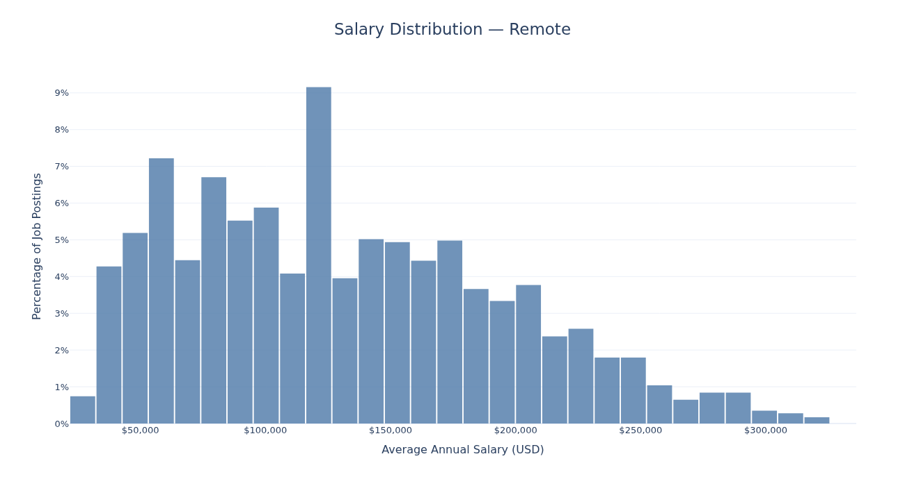

::: {.hero-editorial}
::: {.hero-editorial-main}

[SHOUFENG CHEN · BOSTON]{.brand-line}

# Analytics for decisions that matter.

[Applied Business Analytics graduate student at Boston University combining data, finance, and cloud technology to turn complex evidence into clear business and investment decisions.]{.hero-statement-lead}

::: {.hero-actions}
[Explore Projects](projects.html){.btn .btn-primary}
[View CV](cv.html){.btn .btn-outline-light}
:::

:::

::: {.hero-editorial-side .hero-profile-side}

::: {.profile-photo-frame}

:::

::: {.profile-side-copy}
[PROFILE / 2026]{.side-label}

### Shoufeng Chen

**Boston University**  
MS Applied Business Analytics

**Focus**  
Finance × Analytics × Cloud

**Tools**  
Python · SQL · PySpark · AWS

[GitHub ↗](https://github.com/shoufengchen){.side-link}
:::

:::
:::

::: {.proof-strip}
::: {.proof-item}
[01]{.proof-index}
[815K+]{.proof-value}
[job postings analyzed]{.proof-label}
:::

::: {.proof-item}
[02]{.proof-index}
[$150K]{.proof-value}
[investment evaluated]{.proof-label}
:::

::: {.proof-item}
[03]{.proof-index}
[1]{.proof-value}
[peer-reviewed publication]{.proof-label}
:::
:::

## Selected Work

[Projects are presented as business questions, analytical decisions, and evidence—not as a list of assignments.]{.section-lead}

::: {.showcase-list}

::: {.showcase-item}
::: {.showcase-copy}
[CLOUD ANALYTICS · 01]{.showcase-kicker}

### Employability Analytics

Built a scalable PySpark and Spark SQL workflow on AWS EC2 to analyze **815,193 job postings** and **51,795 companies** across distributed Parquet data.

[View case study →](ad688.html){.showcase-link}
:::

::: {.showcase-visual .showcase-data}
{fig-alt="Salary distribution visualization from the AD688 employability analytics project"}
:::
:::

::: {.showcase-item}
::: {.showcase-copy}
[FINANCIAL STRATEGY · 02]{.showcase-kicker}

### Microbrewery Investment Feasibility

Evaluated a **$150,000** in-house craft beer investment using strategy frameworks, operating forecasts, break-even analysis, ROI, payback, and sensitivity analysis.

[View case study →](ad715.html){.showcase-link}
:::

::: {.showcase-visual .showcase-finance}
[$150K]{.visual-big}
[3-YEAR FORECAST]{.visual-small}
[STRATEGY · OPERATIONS · FINANCE]{.visual-caption}
:::
:::

::: {.showcase-item}
::: {.showcase-copy}
[PUBLISHED RESEARCH · 03]{.showcase-kicker}

### POP MART Consumer Psychology

Published research connecting consumer psychology with scarcity marketing, IP collaboration, social media, and brand-growth strategy in the Chinese blind-box market.

[View research →](research-popmart.html){.showcase-link}
:::

::: {.showcase-visual .showcase-research}
[2024]{.visual-year}
[POP MART]{.visual-title}
[CONSUMER PSYCHOLOGY]{.visual-caption}
:::
:::

:::

## Profile

::: {.profile-grid}
::: {.profile-copy}
I am pursuing a **Master of Science in Applied Business Analytics at Boston University** after completing a Bachelor of Commerce in **Finance and Marketing at Curtin University**.

My experience spans quantitative investment, wealth management, and investment banking. I am especially interested in work where analytical rigor supports a real commercial or investment decision—not modeling for its own sake.
:::

::: {.profile-index}
[WHAT I WORK WITH]{.side-label}

**Data & Cloud**  
Python · SQL · PySpark · Spark SQL · AWS EC2

**Analytics**  
Regression · clustering · cross-validation · machine learning

**Finance**  
DCF · comparable companies · factor screening · sensitivity analysis
:::
:::

## Experience

[Finance-first experience, increasingly powered by data and quantitative methods.]{.section-lead}

::: {.experience-timeline}

::: {.experience-row}
::: {.experience-date}
[2026]{.experience-year}
[MAR—AUG]{.experience-month}
:::

::: {.experience-body}
[QUANTITATIVE INVESTMENT]{.showcase-kicker}

### Hangzhou Fuyonggu Private Fund

**Quantitative Investment Intern**

Worked with QuantConnect, JoinQuant, and Ricequant to study strategy backtesting, factor selection, and systematic-investment workflows, while also examining how quantitative platforms connect technical capability with commercialization.
:::
:::

::: {.experience-row}
::: {.experience-date}
[2024—26]{.experience-year}
[2 TERMS]{.experience-month}
:::

::: {.experience-body}
[WEALTH & MARKET ANALYTICS]{.showcase-kicker}

### SDIC Securities

**Wealth Advisor Intern**

Used Wind, Excel, Python, and SQL for equity, fund, and macro analysis; built a structured fund-evaluation framework that improved proposal-preparation efficiency by approximately **10%** according to supervisor feedback.
:::
:::

::: {.experience-row}
::: {.experience-date}
[2024]{.experience-year}
[JUL]{.experience-month}
:::

::: {.experience-body}
[INVESTMENT BANKING]{.showcase-kicker}

### CITIC Securities

**Investment Banking Intern**

Contributed to **2–3 valuation and forecasting models** using DCF, comparable-company analysis, and sensitivity testing, and supported a new-energy IPO presentation with three-year projections and ESG metrics.
:::
:::

:::

## Capabilities

::: {.capability-grid}

::: {.capability-card}
[01]{.capability-index}

### Analytics & ML

Regression · clustering · cross-validation · machine learning · scikit-learn · data visualization
:::

::: {.capability-card}
[02]{.capability-index}

### Data & Cloud

Python · SQL · PySpark · Spark SQL · Parquet · AWS EC2 · Git/GitHub
:::

::: {.capability-card}
[03]{.capability-index}

### Finance & Markets

DCF · comparable companies · sensitivity analysis · factor screening · Wind · Excel · strategy backtesting
:::

::: {.capability-card}
[04]{.capability-index}

### Research & Strategy

Market research · PESTEL · Five Forces · SWOT · investment feasibility · business reporting
:::

:::

## Career Direction

I am interested in roles where **data analytics, financial decision-making, and technology** come together—including business analytics, financial analytics, quantitative research, fintech, and data-driven strategy.

> I enjoy turning complex datasets into clear decisions, combining technical analysis with business context rather than treating modeling as an isolated exercise.

::: {.homepage-contact}
::: {.homepage-contact-copy}
[OPEN TO CONVERSATIONS]{.brand-line}

## Analytics, finance, and technology—applied to real decisions.

I am currently based in Boston and interested in opportunities spanning business analytics, financial analytics, fintech, quantitative research, and data-driven strategy.
:::

::: {.homepage-contact-actions}
[Contact](contact.html){.btn .btn-primary .btn-lg}
[Download CV](assets/Shoufeng_Chen_CV.pdf){.btn .btn-outline-dark .btn-lg download="Shoufeng_Chen_CV.pdf"}
:::
:::
